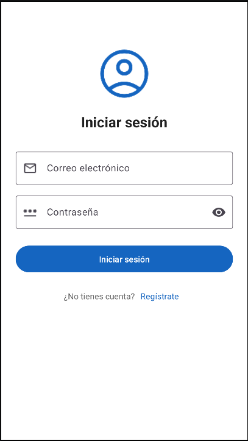
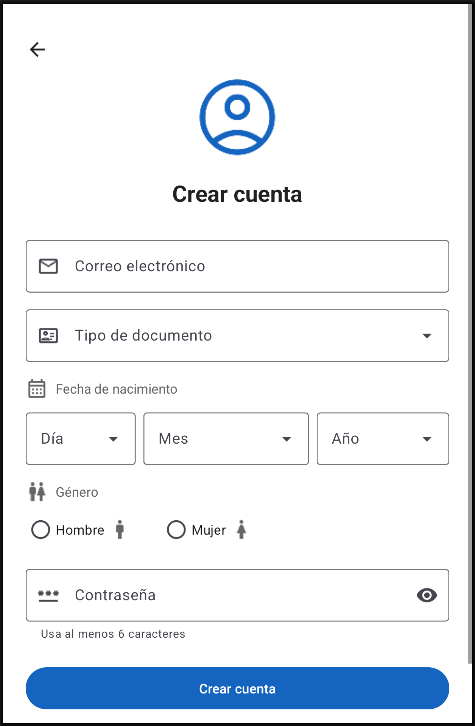

# Práctica 02 · Login y registro (App Móvil)

Aplicación Android sencilla con dos pantallas: **inicio de sesión** y **registro de cuenta**. Está hecha en Java con vistas XML y componentes de Material Design 3.

## Capturas

| Iniciar sesión | Crear cuenta |
|:---:|:---:|
|  |  |

## Pantallas

### Iniciar sesión
- Correo electrónico y contraseña (con botón para mostrarla u ocultarla).
- Botón **Iniciar sesión**: comprueba que el correo exista y que la contraseña sea correcta. Si todo está bien, muestra el mensaje *"Bienvenido, correo"*.
- Enlace **Regístrate** para ir a crear una cuenta.

### Crear cuenta
- **Correo electrónico**: debe tener formato válido y no estar registrado.
- **Tipo de documento**: lista desplegable con DNI, Carné de extranjería y Pasaporte.
- **Fecha de nacimiento**: tres listas desplegables (día, mes y año). No acepta fechas que no existen (por ejemplo, 31 de febrero) ni fechas posteriores a hoy.
- **Género**: radio buttons Hombre / Mujer.
- **Contraseña**: mínimo 6 caracteres.
- Si falta un dato o es incorrecto, el error aparece debajo del campo. Al crear la cuenta se vuelve al login.

## Cómo se guardan los datos

Las cuentas se guardan en el propio teléfono con `SharedPreferences` (no hay servidor). La contraseña no se guarda en texto plano: se guarda su hash SHA-256.

## Estructura del proyecto

```
app/src/main/
├── java/com/practica02S2appmovil/
│   ├── LoginActivity.java      # Pantalla de inicio de sesión (pantalla principal)
│   ├── RegistroActivity.java   # Pantalla de registro
│   ├── AlmacenUsuarios.java    # Guarda y valida las cuentas
│   └── Pantalla.java           # Utilidades comunes (validaciones, márgenes de pantalla)
├── res/layout/
│   ├── activity_login.xml
│   └── activity_registro.xml
├── res/drawable/               # Iconos (usuario, correo, contraseña, género, etc.)
└── res/values/                 # Textos, colores y estilos
```

## Requisitos

- Android Studio (versión reciente)
- SDK de Android 37 (`compileSdk 37`), `minSdk 34`
- Probado en el emulador **Pixel 9 Pro** (Android 37)

## Cómo ejecutarlo

1. Clonar el repositorio:
   ```bash
   git clone https://github.com/darcalleg-soft/PRACTICA02-S2-APPMOVIL.git
   ```
2. Abrir la carpeta en Android Studio y esperar a que Gradle sincronice.
3. Elegir el emulador (por ejemplo Pixel 9 Pro) y pulsar **Run ▶**.
4. En la app, primero crear una cuenta con **Regístrate** y luego iniciar sesión con ese correo y contraseña.

> Si el emulador muestra una versión anterior de la app, usa **Build → Clean Project** y vuelve a pulsar **Run**, o desinstala la app del emulador antes de ejecutarla.
